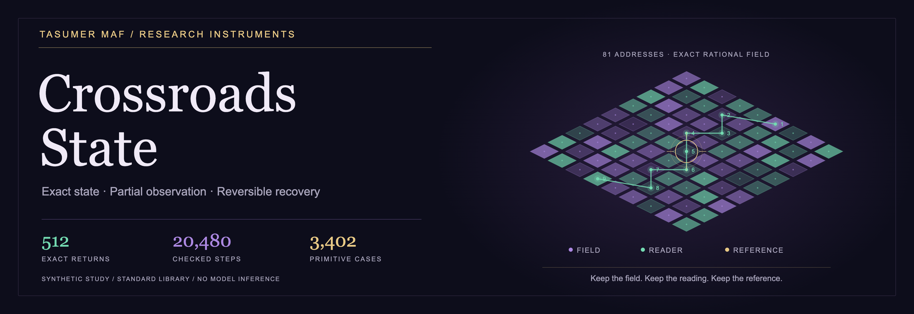
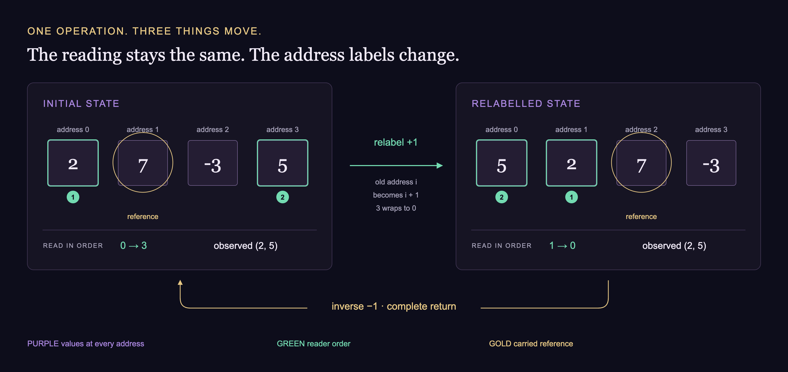

[](https://github.com/tasumermaf/crossroads-state/actions/workflows/test.yml)
[](pyproject.toml)
[](registration.json)
[](LICENSING.md)

# Crossroads State

**Exact state, partial observation, and reversible recovery.**

[**Paper PDF**](paper/exact-state-recovery.pdf) · [Methods](paper/methods.md) ·
[Reproduce](#reproduce-without-installing-anything) ·
[Recorded results](results/synthetic-study.json) · [State contract](#what-the-state-contains)

A small, reproducible Python environment for testing whether a system recovers
its entire state, rather than merely reproducing what a narrow observation
window happens to show. It stores exact rational values, the ordered reading
window, and the carried reference together. It also checks recovery by replaying
a complete journal from a known initial state.

> **Research status · release candidate 0.1.0.** A deterministic software study
> with public synthetic fixtures, an independent implementation check, and an
> inspectable methods paper. This is a reusable exact-state test environment;
> LLM performance, compression advantage and physical information transfer were
> not evaluated. Noncommercial research is free under the
> [research license](LICENSING.md). All enterprise work, including internal
> research and evaluation, requires written permission and payment.

## The instrument

The same reading can appear twice while the underlying state has changed.
Crossroads State keeps the full field, the order in which it is read, and its
reference address together, so **an exact return can be checked rather than
inferred from appearances**.

The figure below uses four addresses to make the rule visible. The complete
synthetic study uses 81. Green numbers show the reader's order; gold marks the
carried reference. Relabel every component together and the observed pair stays
the same. Apply the inverse and the full state returns.



[Inspect the figure's exact data](assets/state-contract.json) ·
[Regenerate the original vector artwork](scripts/build_assets.py)

## What is demonstrated

The committed [synthetic study](results/synthetic-study.json) uses 512 seeded
instruction sequences, each 40 steps long, on 16 independently generated
81-address fixtures. It does not distribute the private source arrays or
reading windows that motivated the prototype.

| Test | Result |
| --- | ---: |
| Full checkpoint restored exactly | 512 / 512 |
| Known initial state + complete journal reproduced the endpoint | 512 / 512 |
| Recorded inverse restored the initial full state | 512 / 512 |
| Independently implemented oracle agreed at each trace step | 20,480 / 20,480 |
| Oracle agreed on primitive/count/reference cases | 3,402 / 3,402 |
| Array, reader, and reference mutations rejected without recomputing checksum | 512 / 512 each |
| Truncated journal changed endpoint | 512 / 512 |
| Reversed instruction order changed endpoint | **511 / 512** |
| Shuffled instruction order changed endpoint | 512 / 512 |

The one reversed-order agreement is retained. Different histories can lead to
the same endpoint; a checkpoint is not a record of the route taken. Likewise,
two different arrays can show the same nine readings. An included example
becomes distinguishable after one declared reading-window shift.

The independent oracle is a separate coordinate-dictionary implementation,
written against the specification without calling the production engine.
This is implementation cross-checking, **not external peer review**.

## Reproduce without installing anything

Python 3.10 or later; the engine and tests use only the standard library.
Run these commands from the repository root:

```sh
PYTHONPATH=src python3 -m unittest discover -s tests -v
python3 scripts/reproduce.py --check
```

The first command runs 17 focused tests. The second recomputes every registered
case and compares the complete machine-readable result with the committed file.
To regenerate that file deliberately, omit `--check`.

The [CI workflow](https://github.com/tasumermaf/crossroads-state/actions/workflows/test.yml)
runs both commands. Its live status is reported by the badge above; the committed
study records the reproducible result independently of the hosting service.

## Try a checkpoint and return

```sh
PYTHONPATH=src python3 -m crossroads_state demo --output start.json
PYTHONPATH=src python3 -m crossroads_state verify start.json
PYTHONPATH=src python3 -m crossroads_state replay start.json examples/journal.json --output arrival.json
PYTHONPATH=src python3 -m crossroads_state replay arrival.json examples/journal.json --inverse --output returned.json
cmp start.json returned.json
```

The CLI refuses to overwrite an existing output. Its built-in model is the
public synthetic fixture only. The Python API accepts other finite address
sets and exact operation definitions; see [the methods paper](paper/methods.md).

## What the state contains

An **array** is the numerical field at every address. A **reader** is an ordered
selection of addresses, so changing its order changes how the field is read.
A **reference** is an address carried by the state, which moves when the
coordinate frame moves. A **journal** is the ordered list of instructions.

A passive change of coordinates moves the array, reader and reference together.
The observed values stay the same even though their address labels change.
Changing a reader alone can expose previously hidden values. Adding a field
changes the values themselves. Keeping these operations separate makes their
inverses testable.

The fixture happens to use a four-label ternary address space: each label is
-1, 0, or +1, giving 3 x 3 x 3 x 3 = 81 addresses. This is a finite computational
address system. No astronomical, spiritual or physical interpretation is needed
to execute or verify it.

## Scope and limits

- The checkpoint contains exact rational strings and a model fingerprint.
  A checkpoint for another operation definition is rejected.
- SHA-256 detects changes when the original digest is retained. It is unkeyed:
  an editor can change the state and recompute the digest. It does not prove
  authorship, authenticity, correctness of a model, or historical truth.
- Exact replay requires the known initial state, the full ordered journal,
  and the same instruction definitions. Endpoint recovery does not recover a
  unique history.
- The 512 tests are deterministic software checks, not a sample of LLM behavior.
  Possible agent-memory applications need separate comparative experiments.
- Parsing is intended for trusted local research files. Resource limits,
  hostile-input hardening, durable storage and distributed consistency are not
  supplied by this small library.

## Files worth reading

- [Methods paper](paper/methods.md) and [PDF](paper/exact-state-recovery.pdf)
- [Registered protocol](registration.json)
- [Test results](results/synthetic-study.json)
- [Engine](src/crossroads_state/core.py)
- [Synthetic fixture definition](src/crossroads_state/synthetic.py)
- [Independent oracle](tests/oracle.py)
- [Privacy manifest](PRIVACY.md)

The runtime has no external dependencies, network calls, model APIs, telemetry,
source downloads or credentials. Rendering the optional PDF uses ReportLab;
the readable paper source and all computational checks do not require it.

## Research and enterprise licensing

The original code, paper, figures and interface assets use the
[TASUMER MAF Research and Enterprise License 1.0](LICENSE).
Personal study, noncommercial teaching and academic research, reproduction of
experiments, and publication of research findings are permitted without a fee
under its terms. Permitted copies and modifications must retain the license,
attribution and change notices.

**Any work for an enterprise requires separate written permission and payment.**
This includes a company's internal research, benchmarking, evaluation, pilots,
and employee or contractor work, regardless of company size or whether a
product is released. There is no free enterprise evaluation exception.

See the [plain-language guide](LICENSING.md) and [full terms](LICENSE).
This is a source-available research release, not an unrestricted open-source
license. Separately licensed third-party works retain their own terms.

## Within TASUMER MAF

[**rhombic**](https://github.com/tasumermaf/rhombic) contains the separate
[XR-001: *Typed State Beats Prose* study](https://github.com/tasumermaf/rhombic#xr-001-typed-state-beats-prose-july-2026),
an empirical investigation of numeric corruption during agent context
compaction. Crossroads State supplies a different kind of artifact: an exact,
deterministic state contract and a synthetic environment in which recovery can
be checked. The 512 sequences here are software tests, **not additional LLM
trials or a reproduction of XR-001**. The two studies retain their own methods,
data and claims.

---

Built by [**TASUMER MAF**](https://tasumermaf.com) ·
[Source and tests](src/crossroads_state) · [Custody boundary](PRIVACY.md) ·
[Research and enterprise licensing](LICENSING.md)
